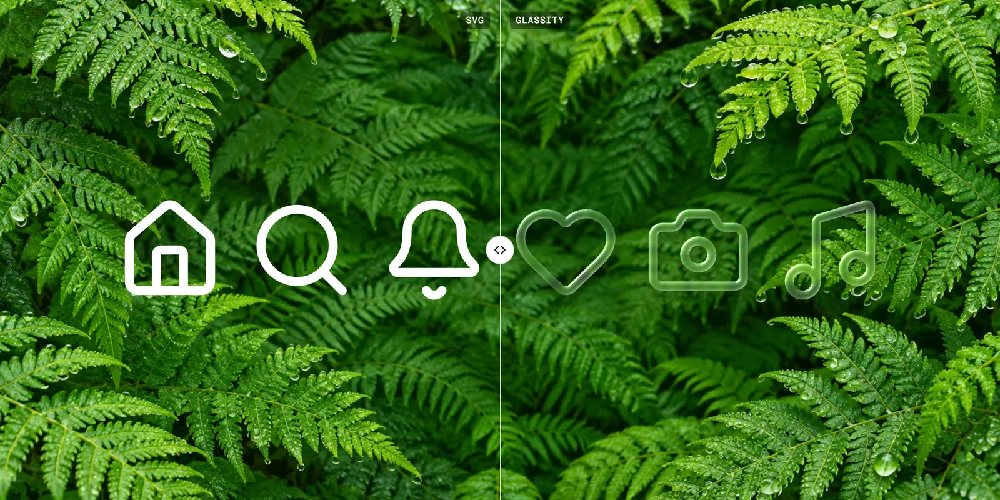
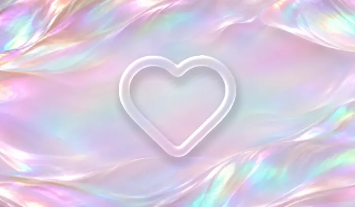
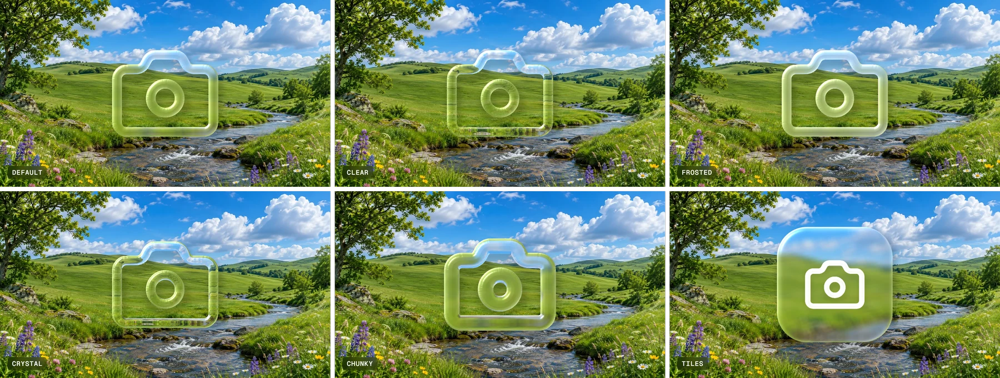
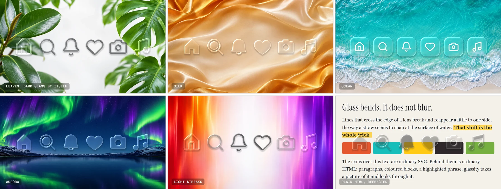
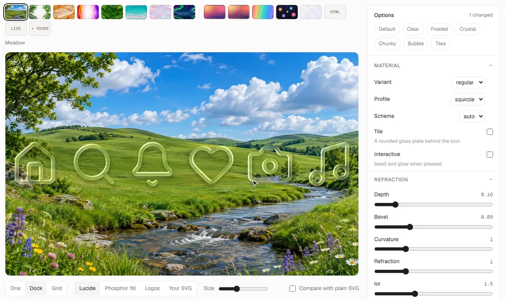

<div align="center">


# glassity

Liquid glass for the SVG icons you already use.

[](https://www.npmjs.com/package/glassity)
[](https://github.com/duckvhuynh/glassity/actions/workflows/ci.yml)
[](LICENSE)

[**Open the playground**](https://duckvhuynh.github.io/glassity/) · [Install](#install) · [Use](#use) · [Options](#options)

</div>

Put `data-glass` on an `<svg>` and it becomes a small lens. The page behind it bends at the edges, splits into colour at the rim, and picks up a highlight that follows the pointer. You keep your icon set: Lucide, Phosphor, Heroicons, Tabler or a logo you drew yourself. glassity reads the outline and does the rest with WebGL2.

```tsx
<GlassProvider>
  <Calendar data-glass />
</GlassProvider>
```

The original `<svg>` stays in the page, so screen readers, focus and clicks see exactly what they saw before. Browsers without WebGL2 show the plain icon.



## What it does

<table>
<tr>
<td width="50%"></td>
<td width="50%"></td>
</tr>
<tr>
<td><b>Shapes morph.</b> Swap the paths inside an icon and the glass flows from the old outline to the new one.</td>
<td><b>Live backdrops.</b> A <code>&lt;video&gt;</code> or <code>&lt;canvas&gt;</code> behind the glass is refracted every frame.</td>
</tr>
</table>



Each look above is a handful of options on the same icon. Thin strokes turn into round tubes, wide shapes get a flat top and a bevelled rim, and `tile` puts the icon on a plate. There are 35 options, all with defaults.



It refracts whatever sits behind it: a photo, a CSS gradient, a canvas, or ordinary HTML text, which it photographs and looks through. Over a light background the glass turns dark by itself.

### Your own icons and logos


Anything drawn as an inline `<svg>` works, filled or stroked: a brand mark, a hand-drawn icon, a logo exported from Figma. The logos above are plain paths from [Simple Icons](https://simpleicons.org), each with `data-glass` and nothing else. In the playground, paste your own SVG under "Your SVG" and see it as glass before you write any code.

### Try the playground

<a href="https://duckvhuynh.github.io/glassity/"></a>

[duckvhuynh.github.io/glassity](https://duckvhuynh.github.io/glassity/) has every option on a slider, presets, 16 backdrops (or your own photo), Lucide, Phosphor, logos or your own SVG, a slider that compares the plain icon with the glass, and the code for React, Vue, Svelte, HTML or plain JavaScript with your settings filled in. The link keeps your settings, so you can share a look.

## Install

```bash
npm install glassity
```

No other package is needed. The framework adapters (`glassity/react`, `glassity/vue`, …) use the framework your app already has. No build step? See [Script tag](#script-tag).

> glassity is at 0.1. The API may change before 1.0; the [changelog](CHANGELOG.md) lists every change, and [Limits](#limits) lists what it does not do yet.

## Use

### React

Wrap your app (or any part of it) once. Every `<svg data-glass>` inside becomes glass.

```tsx
import { GlassProvider } from 'glassity/react';
import { Calendar } from 'lucide-react';

<GlassProvider>
  <Calendar data-glass />
</GlassProvider>
```

Turn a whole icon set into glass without touching each icon:

```tsx
<GlassProvider selector="svg.lucide" tile interactive>
  <Toolbar />
</GlassProvider>
```

Providers nest. The inner one inherits the outer options and overrides them.

Give one icon its own options with `<Glass>`. Swap its child and the glass morphs from one shape to the other.

```tsx
import { Glass } from 'glassity/react';

<Glass tile interactive depth={0.3}>
  <Calendar size={64} />
</Glass>
```

Already have a ref to an `<svg>`? Use the hook.

```tsx
const ref = useRef<SVGSVGElement>(null);
useGlass(ref, { variant: 'clear' });
```

### Vue

```vue
<script setup>
import { GlassProvider, vGlass } from 'glassity/vue';
import { Calendar, House } from '@lucide/vue';
</script>

<template>
  <GlassProvider tile>                    <!-- every [data-glass] inside -->
    <House data-glass />
  </GlassProvider>

  <Calendar v-glass="{ depth: 0.3 }" />   <!-- one icon -->
</template>
```

Options go on `GlassProvider` as attributes (`tile`, `depth="0.3"`, `:interactive="on"`) or together as `:options`. There is also `useGlass(templateRef, options)`.

### Svelte

```svelte
<script>
  import { glass, glassProvider } from 'glassity/svelte';
  import { Calendar, House } from '@lucide/svelte';
</script>

<nav use:glassProvider={{ tile: true }}>
  <House data-glass />
</nav>

<span use:glass={{ depth: 0.3 }}><Calendar /></span>
```

Actions work on elements, so put `use:glass` on the `<svg>` itself or on a wrapper around an icon component.

### Solid

```tsx
import { glass, glassProvider } from 'glassity/solid';
import { Calendar, House } from 'lucide-solid';
void glass, glassProvider; // directives are referenced by name only

<nav use:glassProvider={{ tile: true }}>
  <House data-glass />
</nav>
<span use:glass={{ depth: 0.3 }}><Calendar /></span>
```

### Preact

`glassity/react` works through `preact/compat` (the Vite preset aliases it for you).

### Angular

```ts
import { provideGlassity } from 'glassity/angular';

bootstrapApplication(App, { providers: [provideGlassity({ tile: true })] }); // every [data-glass]
```

For one element or one container, call `injectGlass()` or `injectGlassProvider()` in a constructor. They are plain functions (no decorators, so the package needs no Angular compiler); a directive is a few lines:

```ts
import { Directive, input } from '@angular/core';
import { injectGlass, type GlassOptions } from 'glassity/angular';

@Directive({ selector: '[glass]' })
export class GlassDirective {
  readonly glass = input<GlassOptions | ''>('');
  constructor() {
    injectGlass(() => this.glass() || {});   // options are read as a signal
  }
}
```

Works with zone.js and with zoneless change detection (`provideZonelessChangeDetection`). glassity leaves zone.js zones on its own, so its animation frames and observers never trigger change detection, also when you call `glassify` directly. Nothing runs during server rendering.

### Remix 3

```tsx
import { glass, glassProvider } from 'glassity/remix';

<svg mix={glass({ tile: true })} viewBox="0 0 24 24">…</svg>   {/* one icon */}
<nav mix={glassProvider({ selector: 'svg' })}>…</nav>          {/* a container */}
```

Both are browser-only mixins: they add nothing to the server HTML. Use them inside a client entry. For static server HTML, import `glassity/auto` in your browser entry. Add `glassity` to `allowPackages` in your asset server so the browser may load it. Frame reloads keep the glass: Remix reuses the same `<svg>` and leaves the canvas next to it alone.

### Anything else

Use the core: `glassify(element, options)` after the element is in the page and `destroy()` when it goes, or `auto({ root })` for a container.

### Plain JavaScript

```js
import 'glassity/auto'; // every [data-glass] on the page, now and later
```

```js
import { auto, glassify } from 'glassity';

const page = auto({ selector: 'svg.lucide', tile: true }); // a group
page.update({ depth: 0.3 });

const one = glassify(document.querySelector('#logo'), { variant: 'clear' }); // a single SVG
one.destroy();
```

### Script tag

```html
<script src="https://unpkg.com/glassity"></script>
<svg data-glass ...>...</svg>
```

### Per-icon attributes

| Attribute | Effect |
|---|---|
| `data-glass` | Make this icon glass with the shared options |
| `data-glass="clear"` | Pick a variant (`regular`, `clear`, `identity`) |
| `data-glass="off"` | Leave this icon alone |
| `data-glass-depth="0.3"`, `data-glass-tile`, … | Any option below, in kebab-case |

## Options

Every option is optional. Sizes are fractions of the icon's box, so icons of any size keep the same look.

| Option | Default | What it does |
|---|---|---|
| `variant` | `'regular'` | `regular` keeps content legible; `clear` is see-through; `identity` leaves the SVG untouched |
| `profile` | `'squircle'` | Cross-section of the edge: `squircle`, `circle`, `lip` |
| `tile` | `false` | Put the icon on a rounded glass plate that fills the SVG's box |
| `tileRadius` | `0.26` | Plate corner radius, 0 to 0.5 |
| `glyphOpacity` | `0.9` | How solid the icon is on a plate |
| `padding` | `0` (`0.22` with `tile`) | Inset of the icon inside its box, per side |
| `strokeWidth` | from the SVG | Override the stroke width, in viewBox units |
| `bevel` | `0.09` | Width of the curved edge. Thin strokes use their own half-width |
| `curvature` | `1` | How steep the edge is. `0` is flat glass |
| `depth` | `0.16` | Optical depth: how far light travels after bending |
| `ior` | `1.5` | Index of refraction |
| `refraction` | `1` | Overall strength of the bending |
| `dispersion` | `0.35` (`0.5` clear) | Colour separation at the edges |
| `bands` | `6` | Wavelength bands sampled for dispersion, 1 to 8 |
| `frost` | `0.3` (`0` clear) | Blur of what is seen through the glass |
| `saturation` | `1.35` | Saturation of what is seen through the glass |
| `brightness` | `1` | Brightness of what is seen through the glass |
| `contrast` | `0.9` | Contrast of what is seen through the glass |
| `tint` | `'auto'` | Glass colour. `auto` picks white or near-black from the backdrop |
| `tintOpacity` | `0.14` (`0.04` clear) | How much tint is mixed in |
| `dim` | `0` (`'auto'` clear) | Darkening under the glass. `auto`: up to 35%, only over bright backdrops |
| `opacity` | `1` | Overall opacity |
| `shine` | `1` | Specular highlight |
| `rim` | `1` | Thin light along the edge |
| `reflection` | `0.6` | Reflected surroundings |
| `lightAngle` | `-45` | Light direction in degrees, clockwise from the top |
| `shadow` | `0.3` | Drop shadow |
| `interactive` | `false` | Swell, bounce and glow when pressed |
| `pointerLight` | `true` | The highlight follows the pointer |
| `visible` | `true` | Show or hide. The glass materialises by bending light in and out |
| `duration` | `520` | Materialise and morph time, ms |
| `scheme` | `'auto'` | `auto` reads the backdrop under the icon; `dark` / `light` force it |
| `accessibility` | `true` | Follow the system's accessibility settings (see below) |
| `backdrop` | `'auto'` | What the glass refracts (see below) |
| `maxDpr` | `2` | Upper limit for the device pixel ratio |

## What the glass refracts

WebGL cannot see the page behind a canvas, so glassity builds a picture of it. With `backdrop: 'auto'` it looks for the surface the icon sits on, the nearest ancestor that paints a background:

1. The surface has a background **image or gradient**: that background is refracted. Exact and cheap. This is the usual "icons on a wallpaper" case.
2. The surface has only a **background colour**: its HTML content is rendered to a picture and refracted. The picture is taken again when the content changes.
3. No surface found: the provider's container, or `<body>`, is used the same way.

Or say what to refract:

```tsx
<GlassProvider backdrop="/wallpaper.webp" />   // an image, stretched to cover the container
<GlassProvider backdrop={videoRef} />          // <video> and <canvas> update every frame
<GlassProvider backdrop={someElementRef} />    // a snapshot of that element
<GlassProvider backdrop="none" />              // only the page colour
```

## Compatibility

What has been run, and what is known not to work. The [compatibility suite](compat/README.md) installs the packed package into Vue, Svelte, Solid and Preact apps and checks them in Chromium, Firefox and WebKit; the [browser tests](e2e) cover the cases below.

**Frameworks**

| | |
|---|---|
| React 18/19, Vue 3, Svelte 5, Solid, Preact | Adapters, checked from the packed package |
| Next.js 16, Nuxt 4, SvelteKit 3, React Router 8 (the successor of Remix 2) | Checked end to end (Nuxt also with a `hydrate-on-visible` component that hydrates on scroll): production build, server HTML, hydration, then the same interactions, with both the adapters and `glassity/auto`. The server HTML carries no glass; no hydration warning appears |
| Astro 7 | Checked the same way, with a React island and static markup. Islands that hydrate late (`client:visible`, `client:idle`) are left alone until they have hydrated, then their icons become glass |
| Other server rendering | Importing glassity on the server is safe. `auto()` waits until the page has loaded and gone idle, and skips icons that React, an Astro island or a lazily hydrated Vue component (`hydrateOnVisible` and the other strategies, Nuxt's `hydrate-on-*`) has not hydrated yet |
| Remix 3 | `glassity/remix` mixins, checked end to end: client entries, static server HTML with `glassity/auto`, and frame reloads that reconcile new server HTML into the page |
| Angular 21 with zone.js, Angular 22 zoneless | `glassity/angular`, checked from the packed package in both setups; an idle page with glass causes no change detection in either |
| htmx, Alpine, Turbo, swup, Barba | `auto()` follows DOM changes; pages restored from a clone are cleaned up |
| Jest, CommonJS | `require('glassity')` works (checked in Node). Under jsdom there is no WebGL, so icons should stay plain SVG; not run in Jest yet |
| TypeScript | Types for every `moduleResolution` mode, including `node` |

**Icons**

| | |
|---|---|
| Lucide, Heroicons, Tabler, Feather, Phosphor, Radix, MUI, Ant Design, react-icons, Font Awesome (SVG) | Inline `<svg>`: works. Lucide is checked in every framework; the others are expected to work the same way |
| lucide-react inside a React Server Component | It drops `data-*` props there, so `data-glass` never reaches the `<svg>`. Use `<Glass>` or a provider `selector` in a client component, or mark a wrapper |
| Sprite sheets: `<use href="#id">`, `<use href="icons.svg#id">` | Works: the referenced symbol is copied in. An external sheet must be same-origin or allow CORS |
| Gradients, masks, clip paths defined in another SVG | Works: copied in |
| Web components with an open shadow root (Ionicons, `<iconify-icon>`, Shoelace) | Works: put `data-glass` on the element. A closed shadow root cannot be read |
| Icon fonts (Material Symbols, Font Awesome webfont) | Not supported: there is no SVG to read |

**Living with other libraries**

- The original icon is hidden with a `data-glassity-hidden` attribute and one stylesheet, never with its `style`, so frameworks that rewrite `style` (Vue string styles, Svelte `style="…"`) and animation libraries cannot make it reappear.
- An `opacity` set on the icon itself (GSAP, Motion, the Web Animations API) applies to the glass. Rotation and skew of the icon are not followed.
- glassity adds a `<canvas data-glassity-canvas>` right after each icon. It removes it a moment after `destroy()`, because a framework may still be using it as a position reference during the same update.
- Printing shows the original icons.

**Content Security Policy**

glassity draws the icon and the page snapshot as images, so `img-src` must allow `blob:` and `data:`. Its stylesheet is a constructed sheet, so `style-src` needs no `'unsafe-inline'`. Pages that enforce Trusted Types are fine. If images are blocked the icons simply stay as they are.

## Accessibility

The original SVG is kept (invisible) under the glass, so its accessible name, role, focus and pointer events are unchanged. The canvas is `aria-hidden` and ignores the pointer.

With `accessibility: true` (default) glassity follows the system:

| System setting | Effect |
|---|---|
| Reduce motion | No pointer light, no bounce, transitions are instant |
| Reduce transparency | Frostier, more tinted glass. On Windows this is on when "Transparency effects" is off |
| More contrast | Solid black or white icons |
| Forced colours | Glass is off; the plain SVG shows |

Without WebGL2 the icon stays a plain SVG with a soft highlight.

## Limits

- **Snapshots are pictures, not live content.** In the HTML-snapshot case, web fonts, cross-origin images without CORS, pseudo-elements and iframes may be missing or differ. A snapshot copies at most 1500 nodes; beyond that only the CSS background is used. Use `backdrop` to choose something smaller.
- **A canvas positioned by CSS transforms with rotation or skew** is not handled.
- **Icons do not merge with each other**, and multi-layer icons are treated as one shape.
- **Multicolour SVGs** are used for their outline only.
- Browser tests pass on Chromium, Firefox and WebKit (Playwright builds). Real Safari on macOS and iOS has not been checked yet.
- "Liquid glass" here is a simulation of the look. It is not Apple's shader.

## Develop

```bash
npm install
npm run build      # dist/
npm test           # geometry and options unit tests
npx playwright install chromium firefox webkit   # once
npm run test:e2e   # browser tests on Chromium, Firefox and WebKit (after a build)
npm run test:compat # the packed package in 12 framework apps (after a build)
npm run demo:build # bundles the React demo
npm run demo       # test pages: http://localhost:4173/  and  /demo/react.html
npm run site       # the playground: http://localhost:4173/site/dist/
node site/capture.mjs  # re-renders the images in docs/media (needs the server above and ffmpeg)
```

What is done and what comes next is in [ROADMAP.md](ROADMAP.md); releases are in [CHANGELOG.md](CHANGELOG.md). The design decisions behind 0.1 are in [docs/design.md](docs/design.md) (Vietnamese).

### Releasing

1. Move the `Unreleased` notes in [CHANGELOG.md](CHANGELOG.md) under the new version and bump `version` in `package.json`.
2. Commit, then tag and push: `git tag v0.2.0 && git push origin v0.2.0`.
3. The release workflow publishes to npm and creates the GitHub release from the changelog. It skips publishing if that version is already on npm.
4. If npm puts the version in its staged queue, approve it under Staged Packages on npmjs.com (needs 2FA).

The workflow uses [npm Trusted Publishing](https://docs.npmjs.com/trusted-publishers): no token or secret is stored, and npm attaches provenance. It has to be set up once on npmjs.com, after the package exists: glassity → Settings → Trusted publishing → GitHub Actions, with owner `duckvhuynh`, repository `glassity`, workflow `release.yml`, and direct `npm publish` allowed.

`npm publish` by hand also works (that is how the first version gets onto npm): `prepublishOnly` runs the typecheck, the unit tests and the build first.

## Contributing

Issues and pull requests are welcome. Before opening a pull request, run `npm run typecheck`, `npm test`, `npm run build`, `npm run test:e2e` and `npm run test:compat`, and try the change in the playground and the demo pages.

## License

[MIT](LICENSE) © Duc Huynh

The demo and playground icons are from [Lucide](https://lucide.dev) (ISC licence, see `demo/icons/LICENSE-LUCIDE`) and [Phosphor](https://phosphoricons.com) (MIT). The logos come from [Simple Icons](https://simpleicons.org) (CC0); the marks belong to their owners and are shown only to name the tools glassity works with. The backdrop photos in `site/backdrops` were generated for this project and are covered by the same MIT licence.
