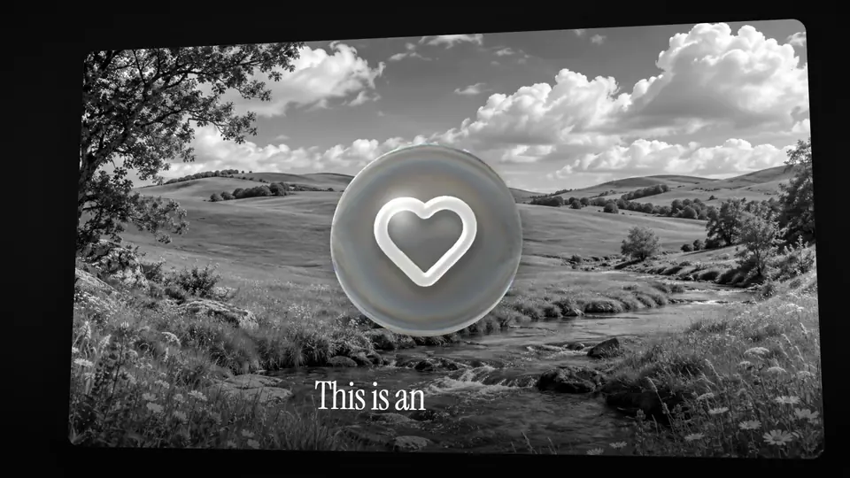
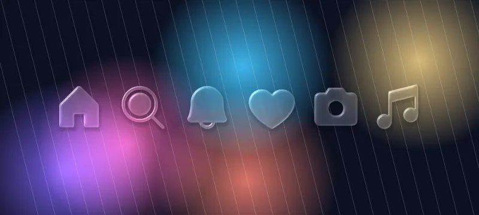
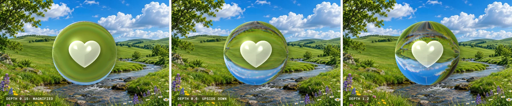
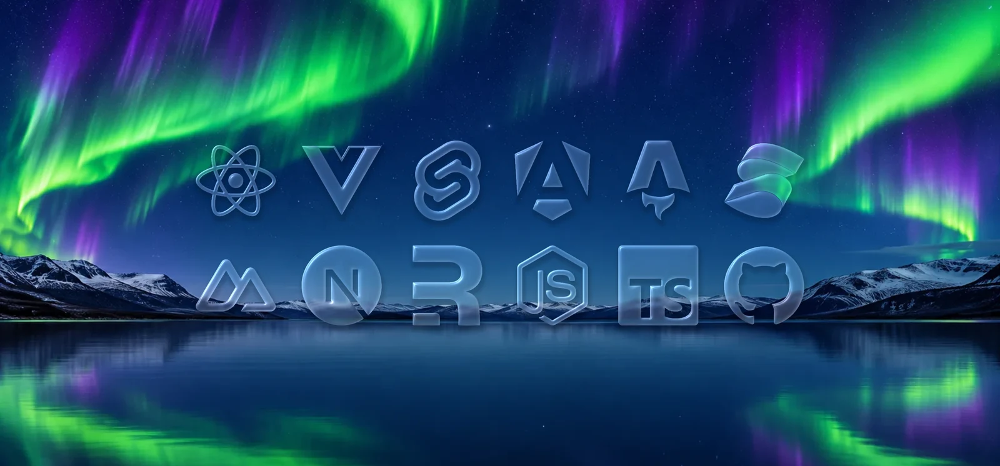

<div align="center">


# glassity

Liquid glass for the SVG icons you already use.

[](https://www.npmjs.com/package/glassity)
[](https://github.com/duckvhuynh/glassity/actions/workflows/ci.yml)
[](LICENSE)

[**Open the playground**](https://duckvhuynh.github.io/glassity/) · [Install](#install) · [Use](#use) · [Options](#options)



</div>

Put `data-glass` on an `<svg>` and it becomes a small lens. The page behind it bends at the edges, splits into colour at the rim, and picks up a highlight that follows the pointer. You keep your icon set: Lucide, Phosphor, Heroicons, Tabler or a logo you drew yourself. glassity reads the outline and does the rest with WebGL2.

```tsx
<GlassProvider>
  <Calendar data-glass />
</GlassProvider>
```

The original `<svg>` stays in the page, so screen readers, focus and clicks see exactly what they saw before. Browsers without WebGL2 show the plain icon.


## What it does

<table>
<tr>
<td width="50%"></td>
<td width="50%"></td>
</tr>
<tr>
<td><b>Shapes morph.</b> Swap the paths inside an icon and the glass flows from the old outline to the new one.</td>
<td><b>Live backdrops.</b> A <code>&lt;video&gt;</code> or <code>&lt;canvas&gt;</code> behind the glass is refracted every frame.</td>
</tr>
</table>



`profile: 'dome'` on a round tile is a ball of glass. Light is traced through both of its surfaces, so it magnifies what is behind it, and from a `depth` of about 0.3 the meadow shows upside down, as it would through a real glass sphere. The heart on it is glass too: marks on a tile lens the plate behind them.


Each look above is a handful of options on the same icon. Thin strokes turn into round tubes, wide shapes get a flat top and a bevelled rim, and `tile` puts the icon on a plate (`tileRadius: 0.5` makes it round). `weight` makes any icon bolder, stroked or filled. Every option has a default.


It refracts whatever sits behind it: a photo, a CSS gradient, a canvas, or ordinary HTML text, which it photographs and looks through. On a white page it stays light, the way Apple's glass does, and is drawn by its own shadow seen through the edge and a thin contour. Small icons, under about 28 px, turn dark there to stay readable. On dark or saturated surfaces they blend toward their own CSS colour by default, keeping dimmed colours dimmer.

### Where it fits

- **Premium landing pages.** Feature icons over a hero photo or gradient look like real glass without redrawing them.
- **Dashboards.** Quick actions and toolbars over a photo or chart header; the rest of the dashboard stays as it is.
- **Mobile web, PWA and hybrid apps** (Capacitor, Ionic). A tab bar and round buttons that bend the feed scrolling under them, close to iOS 26.

All three run live in the playground under [In a real app](https://duckvhuynh.github.io/glassity/#examples), built from [shadcn/ui](https://ui.shadcn.com/blocks) blocks with React and Tailwind; the source is in [site/examples](site/examples).

### Your own icons and logos



Anything drawn as an inline `<svg>` works, filled or stroked: a brand mark, a hand-drawn icon, a logo exported from Figma. The logos above are plain paths from [Simple Icons](https://simpleicons.org), each with `data-glass` and nothing else. In the playground, paste your own SVG under "Your SVG" and see it as glass before you write any code.

### Try the playground

<a href="https://duckvhuynh.github.io/glassity/"></a>

[duckvhuynh.github.io/glassity](https://duckvhuynh.github.io/glassity/) has every option on a slider, presets, 16 backdrops (or your own photo), and icons from Lucide, Phosphor, logos, your own SVG or a library of about 75,000 icons from 21 open sets (Tabler, Material Design, Material Symbols, Font Awesome, Bootstrap, Heroicons, Remix, Solar and more), each searchable and shown in full. It also has a slider that compares the plain icon with the glass, and the code for React, Vue, Svelte, HTML or plain JavaScript with your settings filled in. The link keeps your settings, so you can share a look.

## Install

```bash
npm install glassity
```

No other package is needed. The framework adapters (`glassity/react`, `glassity/vue`, …) use the framework your app already has. No build step? See [Script tag](#script-tag).

### Or onboard your agent with ease

Paste this into Claude Code, Cursor, Codex, Copilot or any coding agent:

```text
Set up glassity for me. Fetch https://cdn.jsdelivr.net/npm/glassity@0.3/get-started.md and follow it.
```

The agent reads [get-started.md](get-started.md): it finds your framework and icon library, installs glassity, wires it in, marks a few icons and checks that the glass shows. [skills/glassity/SKILL.md](skills/glassity/SKILL.md) is the full reference written for agents (every option, recipe and fix); the guide offers to save it in your project so the agent knows glassity next time. Both files also ship in the npm package.

> glassity is at 0.3. The API may change before 1.0; the [changelog](CHANGELOG.md) lists every change, and [Limits](#limits) lists what it does not do yet.

## Use

### React

Wrap your app (or any part of it) once. Every `<svg data-glass>` inside becomes glass.

```tsx
import { GlassProvider } from 'glassity/react';
import { Calendar } from 'lucide-react';

<GlassProvider>
  <Calendar data-glass />
</GlassProvider>
```

Turn a whole icon set into glass without touching each icon:

```tsx
<GlassProvider selector="svg.lucide" tile interactive>
  <Toolbar />
</GlassProvider>
```

Providers nest. The inner one inherits the outer options and overrides them. The default wrapper uses `display: contents`, including when only `className` is supplied; pass `style` to give it a layout.

For page-wide discovery, including icons in portals, use `scope="document"`. It renders only context and children, with no wrapper element. Multiple document providers share one controller, which stays active until the last one unmounts. Their selectors are combined; when options conflict, the last-mounted document provider wins. Removing it restores the remaining providers’ values.

```tsx
<GlassProvider scope="document" look="frosted">
  <App />
</GlassProvider>
```

Give one icon its own options with `<Glass>`. Swap its child and the glass morphs from one shape to the other.

```tsx
import { Glass } from 'glassity/react';

<Glass tile interactive depth={0.3}>
  <Calendar size={64} />
</Glass>
```

Already have a ref to an `<svg>`? Use the hook. If a render points the ref at another element, the glass follows it.

```tsx
const ref = useRef<SVGSVGElement>(null);
useGlass(ref, { look: 'clear' });
```

### Vue

```vue
<script setup>
import { GlassProvider, vGlass } from 'glassity/vue';
import { Calendar, House } from '@lucide/vue';
</script>

<template>
  <GlassProvider tile>                    <!-- every [data-glass] inside -->
    <House data-glass />
  </GlassProvider>

  <Calendar v-glass="{ depth: 0.3 }" />   <!-- one icon -->
</template>
```

Options go on `GlassProvider` as attributes (`tile`, `depth="0.3"`, `:interactive="on"`) or together as `:options`. There is also `useGlass(templateRef, options)`.

### Svelte

```svelte
<script>
  import { glass, glassProvider } from 'glassity/svelte';
  import { Calendar, House } from '@lucide/svelte';
</script>

<nav use:glassProvider={{ tile: true }}>
  <House data-glass />
</nav>

<span use:glass={{ depth: 0.3 }}><Calendar /></span>
```

Actions work on elements, so put `use:glass` on the `<svg>` itself or on a wrapper around an icon component.

### Solid

```tsx
import { glass, glassProvider } from 'glassity/solid';
import { Calendar, House } from 'lucide-solid';
void glass, glassProvider; // directives are referenced by name only

<nav use:glassProvider={{ tile: true }}>
  <House data-glass />
</nav>
<span use:glass={{ depth: 0.3 }}><Calendar /></span>
```

### Preact

`glassity/react` works through `preact/compat` (the Vite preset aliases it for you).

### Angular

```ts
import { provideGlassity } from 'glassity/angular';

bootstrapApplication(App, { providers: [provideGlassity({ tile: true })] }); // every [data-glass]
```

For one element or one container, call `injectGlass()` or `injectGlassProvider()` in a constructor. They are plain functions (no decorators, so the package needs no Angular compiler); a directive is a few lines:

```ts
import { Directive, input } from '@angular/core';
import { injectGlass, type GlassOptions } from 'glassity/angular';

@Directive({ selector: '[glass]' })
export class GlassDirective {
  readonly glass = input<GlassOptions | ''>('');
  constructor() {
    injectGlass(() => this.glass() || {});   // options are read as a signal
  }
}
```

Works with zone.js and with zoneless change detection (`provideZonelessChangeDetection`). glassity leaves zone.js zones on its own, so its animation frames and observers never trigger change detection, also when you call `glassify` directly. Nothing runs during server rendering.

### Remix 3

```tsx
import { glass, glassProvider } from 'glassity/remix';

<svg mix={glass({ tile: true })} viewBox="0 0 24 24">…</svg>   {/* one icon */}
<nav mix={glassProvider({ selector: 'svg' })}>…</nav>          {/* a container */}
```

Both are browser-only mixins: they add nothing to the server HTML. Use them inside a client entry. For static server HTML, import `glassity/auto` in your browser entry. Add `glassity` to `allowPackages` in your asset server so the browser may load it. Frame reloads keep the glass: Remix reuses the same `<svg>` and leaves the canvas next to it alone.

### Anything else

Use the core: `glassify(element, options)` after the element is in the page and `destroy()` when it goes, or `auto({ root })` for a container.

### Plain JavaScript

```js
import 'glassity/auto'; // every [data-glass] on the page, now and later
```

```js
import { auto, glassify } from 'glassity';

const page = auto({ selector: 'svg.lucide', tile: true }); // a group
page.update({ depth: 0.3 });

const one = glassify(document.querySelector('#logo'), { variant: 'clear' }); // a single SVG
one.destroy();
```

### Script tag

```html
<script src="https://unpkg.com/glassity@0.3"></script>
<svg data-glass ...>...</svg>
```

### Glass surfaces

Put `data-glass="surface"` on an HTML container such as a `button`, `nav` or `div` to turn its background into glass. Use it for pills, toolbars and tab bars. Its existing CSS sets the size and border radius, including different or elliptical radii at each corner. Labels, links, selection, focus rings and click targets stay ordinary DOM above the glass. No wrapper or backdrop declaration is needed.

```html
<button data-glass="surface" style="border-radius: 999px">Save</button>
<nav data-glass="surface" data-glass-look="frosted" style="border-radius: 24px">
  <button><svg viewBox="0 0 24 24">…</svg> Home</button>
  <button><svg viewBox="0 0 24 24">…</svg> Search</button>
</nav>
```

The same attributes work inside React and Vue `GlassProvider` components, or with the `glassity/auto` import. If you use a custom selector, include `[data-glass]` to discover the surfaces too. Icons inside a surface stay plain even when a broad selector matches them; add `data-glass` to an inner SVG explicitly if it should also be glass.

```ts
const surface = glassify(document.querySelector('#toolbar')!, {
  surface: true, look: 'clear', frost: 0.2,
});
surface.update({ tint: '#92b5ff', tintOpacity: 0.2 });
surface.destroy(); // restore the element
```

A surface handle's `element` is the original host. `GlassHandle.element` and `retarget(target)` use the exported `GlassElement` type (`SVGSVGElement | HTMLElement`), so a handle can target an HTML surface or an SVG; existing SVG calls continue to work. Code reading SVG-only fields from `handle.element` should first narrow it with `instanceof SVGSVGElement`.

Replaced elements and native controls (`input`, `img`, `video`, `canvas`, `select`, `textarea`) cannot host the rendering canvas and remain unchanged.

Material options such as `look`, `frost`, `tint` and `depth` apply to the slab. CSS controls its geometry and the content; icon options such as `tileRadius`, `padding`, `strokeWidth` and `glyphOpacity` do not style the DOM children. Surface DPR is capped at 1.5 (or a lower `maxDpr`) to bound the cost of large controls, and surfaces in the same region share their backdrop.

### Per-element attributes

| Attribute | Effect |
|---|---|
| `data-glass` | Make this icon glass with the shared options |
| `data-glass="clear"` | Pick a variant (`regular`, `clear`, `identity`) |
| `data-glass="surface"` | Glass background for an element; keep its content as DOM |
| `data-glass="off"` | Leave this icon alone |
| `data-glass-look="frosted"` | Pick a named look |
| `data-glass-environment="studio"` | Keep studio reflections on, including over photos |
| `data-glass-depth="0.3"`, `data-glass-tile`, … | Any option below, in kebab-case |

### Named looks and page defaults

Pick a recipe with `look`: `default`, `clear`, `frosted`, `crystal`, `tinted`, or `bold`. Explicit options override the recipe. Changing `look` removes values supplied by the previous recipe; options you set explicitly keep their values.

```ts
import { auto, configure, looks, type GlassLook } from 'glassity';

configure({ look: 'frosted', duration: 300 }); // existing and future icons
const look: GlassLook = 'crystal';
const icons = auto({ look, shine: 1.2 });
icons.update({ look: 'clear' });             // no leftover crystal depth or dispersion
configure({});                             // reset page defaults

console.log(looks.crystal);                 // readonly recipe, shared with the playground
```

`configure(options)` replaces the page defaults; it does not start discovery. Use it alongside `auto()`, `glassity/auto`, or a framework provider. Importing glassity remains safe during server rendering.

Explicit options apply in this order: page defaults from `configure()`, outer scope, inner scope, element attributes, then an icon's own options. Nested `auto({ root })` scopes inherit by DOM ancestry, and changing an outer scope updates its descendants. The selected look is a recipe beneath all these explicit options, so even an outer scope's explicit `depth` overrides a look's depth.

### Layered app icons

Opt in with `data-glass-layers` and mark each glass body with `<g data-glass-layer="name">`. The first group is the bottom layer; later groups refract the already-rendered glass beneath them. No wrapper or backdrop declaration is needed.

```html
<svg data-glass data-glass-layers data-glass-colors="source"
     viewBox="0 0 100 100" width="96" height="96" role="img" aria-label="App">
  <g data-glass-layer="base" fill="#2479ef">
    <rect x="4" y="4" width="92" height="92" rx="24" />
  </g>
  <g data-glass-layer="mark" data-glass-depth="0.08"
     data-glass-frost="0.1" data-glass-opacity="0.9" fill="#ffffff">
    <circle cx="50" cy="50" r="23" />
  </g>
</svg>
```

Use `appearance` on the SVG or through any adapter:

```ts
const handle = glassify(svg, { layers: true, colors: 'source', appearance: 'dark' });
handle.update({ appearance: 'tinted', tint: '#a38cff' });
```

| Appearance | Layered icon treatment |
|---|---|
| `default` | Inherited glass options and each group's overrides |
| `dark` | A dark body with light marks |
| `clear` | The clear variant with no frost and a faint tint |
| `tinted` | Every layer uses the icon's `tint`, with monochrome content; `auto` uses its CSS colour |

Groups can override material options with attributes such as `data-glass-depth`, `data-glass-frost`, `data-glass-tint`, `data-glass-tint-opacity` and `data-glass-opacity`. Group overrides win over appearance defaults, except `tinted` keeps one tint and zero saturation throughout. Visibility, interaction, accessibility and backdrop belong to the whole icon. A layered icon uses its authored base shape instead of the automatic `tile` plate.

`colors: 'source'` uses each layer's first visible solid fill as its tint (or a solid stroke for stroke-only artwork), mixed at `0.55` by default. A group's explicit tint or tint opacity overrides it. It is one colour per layer: gradients and patterns are not reproduced as colour textures. Dark and tinted appearances replace the source palette; clear keeps only a faint tint.

To bound memory and draw cost, glassity renders at most **four marked groups**, in SVG document order; additional marked groups are omitted. Ordinary exporter groups never become layers automatically. Unmarked artwork outside marked groups is omitted in layered mode; keep it inside a layer. Nested marked groups render separately and are excluded from their parent's shape. Definitions, masks and clip paths remain available but are not themselves layers. An SVG with no marked groups keeps the usual single-body rendering, and `appearance` has no effect on it. Adding, removing or reordering a layer updates the stack; layer geometry changes replace the stack together without a per-layer shape morph.

### Seekable morph sequences

Use a handle when a slider, scroll library or timeline should control the shape. Pass at least two SVG elements or complete SVG markup strings; every shape is preloaded into the same raster frame, using the mounted icon's size. Resizing reloads that frame while preserving the controller and playback position.

```ts
import { glassify, type SequenceController } from 'glassity';

const handle = glassify(document.querySelector('svg')!);
const sequence: SequenceController = handle.sequence([heartSvg, starSvg, checkSvg], {
  duration: 1800, // total milliseconds across the sequence
  loop: false,
  autoplay: false,
});
await sequence.ready;
sequence.seek(0.5); // star; any value from 0 to 1, also from a scroll callback
sequence.play();
sequence.pause();
sequence.cancel(); // freeze the current shape
const result = await sequence.finished; // 'completed' or 'cancelled'
```

The defaults are `duration: 1000`, `loop: false` and `autoplay: true`. Adjacent shapes get equal time, and `progress` is readable on the controller. `seek()` preserves whether playback is paused or running. `play()` after completion restarts at the beginning; `finished` settles once, for the first completion or cancellation. A cancelled controller cannot restart; create another sequence. Looping returns to the first shape; repeat the first shape at the end for a continuous loop.

Starting another sequence while a morph or sequence is in progress uses the current visible blend as its first shape, so interruption does not jump. Cancelling keeps that blend too. The original SVG is unchanged. With reduced motion, `play()` jumps to the last shape, even with `loop: true`; manual `seek()` still works. `ready` rejects invalid or empty shapes and icons that have no laid-out size. Without WebGL2, during server rendering, with `variant: 'identity'`, or in forced colours, the controller is cancelled and the original SVG stays unchanged.

### Interaction presets

Set `interactive` on your existing icons or provider. `interaction: 'subtle'` is the default; `'bouncy'` gives a larger spring, and `'none'` disables interaction feedback. The same settings work as attributes:

```html
<button aria-label="Save">
  <svg data-glass data-glass-interactive data-glass-interaction="bouncy" viewBox="0 0 24 24">…</svg>
</button>
```

Hover and keyboard focus-visible gently lift the highlight. Pointer presses and Enter/Space on the host button swell the glass. The shape deforms in the shader, so the sampled backdrop stays in screen space. A press also casts a brief light onto nearby glass within about 120 px. Reduced motion keeps static feedback and disables the swell and spreading light. No extra wrapper or backdrop declaration is needed.

Try the sequence scrubber and interactive tiles at `/e2e/fixtures/motion.html` after `npm run build` and `npm run demo`.

## Options

Every option is optional. Sizes are fractions of the icon's box, so icons of any size keep the same look.

| Option | Default | What it does |
|---|---|---|
| `look` | `'default'` | Named recipe: `default`, `clear`, `frosted`, `crystal`, `tinted`, or `bold`. Explicit options override it |
| `layers` | `false` | Render explicitly marked `g[data-glass-layer]` groups separately, bottom to top; at most four |
| `colors` | `'default'` | `source` uses each layer's SVG fill or stroke as its tint; layered icons only |
| `appearance` | `'default'` | Layered icon treatment: `default`, `dark`, `clear`, or `tinted` |
| `variant` | `'regular'` | `regular` keeps content legible; `clear` is see-through; `identity` leaves the SVG untouched |
| `profile` | `'squircle'` | Cross-section of the edge: `squircle`, `circle`, `lip`, or `dome`, a ball of glass that magnifies and, with `depth` from about 0.3, shows the page upside down. Best on a round tile |
| `surface` | `false` | Glass background for an HTML container, sized and rounded by its CSS; content stays on top |
| `tile` | `false` | Put the icon on a rounded glass plate that fills the SVG's box |
| `tileRadius` | `0.26` | Plate corner radius, 0 to 0.5. `0.5` makes a round button |
| `glyphOpacity` | `0.9` | How solid the icon is on a plate |
| `padding` | `0` (`0.22` with `tile`) | Inset of the icon inside its box, per side |
| `strokeWidth` | from the SVG | Override the stroke width, in viewBox units. Stroked icons only |
| `weight` | `0` | Make any shape bolder, stroked or filled, as a fraction of the box: up to `0.08`, down to `-0.03` |
| `bevel` | `0.09` | Width of the curved edge. Thin strokes use their own half-width |
| `curvature` | `1` | How steep the edge is. `0` is flat glass |
| `depth` | `0.16` | Optical depth: how far light travels after bending |
| `ior` | `1.5` | Index of refraction |
| `refraction` | `1` | Overall strength of the bending |
| `dispersion` | `0.35` (`0.5` clear) | Colour separation at the edges |
| `bands` | `6` | Wavelength bands sampled for dispersion, 1 to 8 |
| `frost` | `0.3` (`0` clear) | Blur of what is seen through the glass |
| `saturation` | `1.35` | Saturation of what is seen through the glass |
| `brightness` | `1` | Brightness of what is seen through the glass |
| `contrast` | `0.9` | Contrast of what is seen through the glass |
| `tint` | `'auto'` | Glass colour: any CSS colour, `currentColor` (the icon's computed `color`), or `auto`. Small automatic icons turn near-black on light neutral surfaces and blend toward their CSS colour on dark or saturated surfaces |
| `tintOpacity` | `0.14` (`0.04` clear) | How much tint is mixed in |
| `legibility` | `'auto'` | Help small glyphs read on dark or saturated backdrops when `tint` is `auto`. `off` disables this contrast correction; explicit tints are unchanged |
| `dim` | `0` (`'auto'` clear) | Darkening under the glass. `auto`: up to 35%, only over bright, busy backdrops such as photos; none on a plain light page |
| `opacity` | `1` | Overall opacity |
| `shine` | `1` | Specular highlight |
| `rim` | `1` | Thin light along the edge |
| `reflection` | `0.6` | Reflected surroundings |
| `environment` | `'auto'` | Studio reflections: `auto` adds light on flat surfaces and fades it over detailed backdrops; `studio` keeps it on; `none` keeps the original reflection |
| `lightAngle` | `-45` | Light direction in degrees, clockwise from the top |
| `shadow` | `0.3` | Drop shadow |
| `interactive` | `false` | Enable hover, focus-visible and pointer/keyboard press feedback |
| `interaction` | `'subtle'` | `none`, `subtle` or `bouncy`; preset used when `interactive` is true |
| `pointerLight` | `true` | The highlight follows the pointer |
| `visible` | `true` | Show or hide. The glass materialises by bending light in and out |
| `duration` | `520` | Materialise and morph time, ms |
| `scheme` | `'auto'` | `auto` reads the backdrop under the icon; `dark` / `light` force it |
| `accessibility` | `true` | Follow the system's accessibility settings (see below). Forced colours always apply |
| `backdrop` | `'auto'` | What the glass refracts (see below) |
| `maxDpr` | `2` | Upper limit for the device pixel ratio; surfaces also cap it at 1.5 |

Small icons on dark and saturated surfaces now look different by default. The adjustment follows the sampled backdrop and the icon's CSS `color`, including its alpha, with smooth size and contrast ramps. If the CSS colour itself has too little contrast, automatic mode shifts it toward contrasting light or dark ink. Class, state and theme changes are picked up automatically. Size means the glyph after padding: a 48 px tile with the default padding has a glyph of about 27 px.

```ts
glassify(svg, { tint: 'currentColor', tintOpacity: 0.55 }); // follow CSS colour explicitly
glassify(svg, { legibility: 'off' }); // disable the dark/saturated backdrop correction
```

The same options work on providers and as `data-glass-tint="currentColor"` or `data-glass-legibility="off"`. An explicit tint, including `currentColor`, keeps your chosen `tintOpacity` and bypasses automatic legibility. The corrected glyph sizing after padding still applies with `legibility: 'off'`, so padded tiles can differ from earlier releases.

### Lighting on flat surfaces

The default `environment: 'auto'` gives solid buttons and plain dashboards a broad window reflection, a softer fill and a dark horizon band. The lights take their colour from the backdrop and fade as backdrop detail increases, keeping the look over photos essentially unchanged. Frost broadens the highlights; `reflection` controls their strength, and Fresnel keeps them restrained. No extra wrapper or backdrop declaration is needed.

```ts
glassify(svg, { environment: 'studio' }); // keep the studio lights on over any backdrop
glassify(svg, { environment: 'studio', frost: 0.6 }); // softer highlights
glassify(svg, { environment: 'none' }); // keep the original ambient reflection
```

The same option works on providers and as `data-glass-environment="studio"`. `environment: 'none'` only disables the added studio lights; `reflection: 0` disables reflected surroundings altogether.

## What the glass refracts

WebGL cannot see the page behind a canvas, so glassity builds a picture of it. With `backdrop: 'auto'` it looks for the surface the icon sits on, the nearest ancestor that paints a background:

1. The surface has a background **image or gradient**: that background is refracted. Exact and cheap. This is the usual "icons on a wallpaper" case.
2. The surface has only a **background colour**: its HTML content is captured around nearby icons and refracted. Shared local regions include space for refraction and blur, keep screen-level detail on long pages, and refresh when content or scrolling changes.
3. No surface found: the provider's container, or `<body>`, is used the same way.

HTML captures share a queue that prioritises visible regions and yields between small pieces of DOM work. The previous good picture stays visible while a replacement is prepared; stale captures are discarded. Extremely dense regions still fall back to their CSS background when the local node budget is exceeded.

Where the browser exposes HTML-in-Canvas, glassity can follow native paint events for an **already-rendered drawable subtree in an application-owned canvas**, without cloning or moving its HTML. This is feature-detected, never selected by browser version. Current native APIs bind drawable elements to their owning canvas; they cannot capture arbitrary page HTML into glassity’s canvas. Ordinary HTML therefore keeps the local snapshot path, including on Chrome 157+, and CSS-only animation there is not live. No wrapper, backdrop declaration or new option is required for normal use. See [Chrome’s HTML-in-Canvas documentation](https://developer.chrome.com/docs/web-platform/html-in-canvas/concepts).

Or say what to refract:

```tsx
<GlassProvider backdrop="/wallpaper.webp" />   // an image, stretched to cover the container
<GlassProvider backdrop={videoRef} />          // <video> and <canvas> update every frame
<GlassProvider backdrop={someElementRef} />    // a snapshot of that element
<GlassProvider backdrop="none" />              // only the page colour
```

## Compatibility

What has been run, and what is known not to work. The [compatibility suite](compat/README.md) installs the packed package into twelve framework apps (Vue, Svelte, Solid, Preact, Angular 21 and 22, Next.js, Nuxt, SvelteKit, Astro, React Router and Remix 3) and checks them in Chromium and WebKit; the [browser tests](e2e) cover the cases below in Chromium, Firefox and WebKit.

**Frameworks**

| | |
|---|---|
| React 19, Vue 3, Svelte 5, Solid, Preact | Adapters, checked from the packed package. React 18 is in the supported range but not in the suite |
| Next.js 16, Nuxt 4, SvelteKit 3, React Router 8 (the successor of Remix 2) | Checked end to end (Nuxt also with a `hydrate-on-visible` component that hydrates on scroll): production build, server HTML, hydration, then the same interactions, with both the adapters and `glassity/auto`. The server HTML carries no glass; no hydration warning appears |
| Astro 7 | Checked the same way, with a React island and static markup. Islands that hydrate late (`client:visible`, `client:idle`) are left alone until they have hydrated, then their icons become glass |
| Other server rendering | Importing glassity on the server is safe. `auto()` starts after DOM readiness and a bounded idle wait, and skips icons that React, an Astro island or a lazily hydrated Vue component (`hydrateOnVisible` and the other strategies, Nuxt's `hydrate-on-*`) has not hydrated yet |
| Remix 3 | `glassity/remix` mixins, checked end to end: client entries, static server HTML with `glassity/auto`, and frame reloads that reconcile new server HTML into the page |
| Angular 21 with zone.js, Angular 22 zoneless | `glassity/angular`, checked from the packed package in both setups; an idle page with glass causes no change detection in either |
| htmx, Alpine, Turbo, swup, Barba | `auto()` follows DOM changes; pages restored from a clone are cleaned up |
| Jest, CommonJS | `require('glassity')` works (checked in Node). Under jsdom there is no WebGL, so icons should stay plain SVG; not run in Jest yet |
| TypeScript | Types for every `moduleResolution` mode, including `node` |

**Icons**

| | |
|---|---|
| Lucide, Heroicons, Tabler, Feather, Phosphor, Radix, MUI, Ant Design, react-icons, Font Awesome (SVG) | Inline `<svg>`: works. Lucide is checked in every framework; the others are expected to work the same way |
| lucide-react inside a React Server Component | It drops `data-*` props there, so `data-glass` never reaches the `<svg>`. Use `<Glass>` or a provider `selector` in a client component, or mark a wrapper |
| Sprite sheets: `<use href="#id">`, `<use href="icons.svg#id">` | Works: the referenced symbol is copied in. An external sheet must be same-origin or allow CORS |
| Gradients, masks, clip paths defined in another SVG | Works: copied in |
| Web components with an open shadow root (Ionicons, `<iconify-icon>`, Shoelace) | Works: put `data-glass` on the element. A closed shadow root cannot be read |
| Icon fonts (Material Symbols, Font Awesome webfont) | Not supported: there is no SVG to read |

**Living with other libraries**

- The original icon is hidden with a `data-glassity-hidden` attribute and one stylesheet, never with its `style`, so frameworks that rewrite `style` (Vue string styles, Svelte `style="…"`) and animation libraries cannot make it reappear.
- An `opacity` set on the icon itself (GSAP, Motion, the Web Animations API) applies to the glass. Rotation and skew of the icon are not followed.
- glassity adds a `<canvas data-glassity-canvas>` right after each icon. It removes it a moment after `destroy()`, because a framework may still be using it as a position reference during the same update.
- Printing shows the original icons.

**Content Security Policy**

glassity draws the icon and the page snapshot as images, so `img-src` must allow `blob:` and `data:`. Its stylesheet is a constructed sheet, so `style-src` needs no `'unsafe-inline'`. Pages that enforce Trusted Types are fine. If images are blocked the icons simply stay as they are.

## Accessibility

The original SVG is kept (invisible) under the glass, so its accessible name, role, focus and pointer events are unchanged. The canvas is `aria-hidden` and ignores the pointer.

With `accessibility: true` (default) glassity follows the system:

| System setting | Effect |
|---|---|
| Reduce motion | No pointer light, swell or spreading touch light; transitions and sequence playback jump to the end. Manual sequence seeking still works |
| Reduce transparency | Frostier, more tinted glass. On Windows this is on when "Transparency effects" is off |
| More contrast | Solid black or white icons |
| Forced colours | Glass is off; the plain SVG shows. This applies even with `accessibility: false` |

Without WebGL2 the icon stays a plain SVG with a soft highlight.

## Limits

- **Snapshots are pictures, not live content.** In the HTML-snapshot case, web fonts, cross-origin images without CORS, pseudo-elements and iframes may be missing or differ. A snapshot copies at most 1500 nodes; beyond that only the CSS background is used. Use `backdrop` to choose something smaller.
- **SVG icons positioned by CSS transforms with rotation or skew** are not handled. Surfaces follow their own and their ancestors' 2D transforms, including scale, rotation and skew. Under 3D or perspective transforms the surface still follows the DOM, but backdrop sampling remains planar.
- **Icons do not merge with each other.** Within one SVG, opt-in layered icons support up to four marked glass bodies.
- **Multicolour SVGs** use their outline by default. Layered icons with `colors: 'source'` use one solid tint per layer, not per-pixel SVG colours.
- Browser tests pass on Chromium, Firefox and WebKit (Playwright builds). Real Safari on macOS and iOS has not been checked yet.
- "Liquid glass" here is a simulation of the look. It is not Apple's shader.

## Develop

```bash
npm install
npm run build      # dist/
npm test           # geometry and options unit tests
npx playwright install chromium firefox webkit   # once
npm run test:e2e   # browser tests on Chromium, Firefox and WebKit (after a build)
npm run test:compat # the packed package in 12 framework apps (after a build)
npm run bench      # local Chromium performance matrix and budget reports (not CI)
npm run demo:build # bundles the React demo
npm run demo       # test pages: http://localhost:4173/  and  /demo/react.html
npm --prefix site/examples ci   # once, for the real-app examples
npm run site       # the playground: http://localhost:4173/site/dist/
node site/capture.mjs  # re-renders the images in docs/media (needs the server above and ffmpeg)
```

What is done and what comes next is in [ROADMAP.md](ROADMAP.md); releases are in [CHANGELOG.md](CHANGELOG.md). The design decisions behind 0.1 are in [docs/design.md](docs/design.md) (Vietnamese).

### Releasing

1. Move the `Unreleased` notes in [CHANGELOG.md](CHANGELOG.md) under the new version and bump `version` in `package.json`.
2. Commit, then tag and push: `git tag v0.2.0 && git push origin v0.2.0`.
3. The release workflow publishes to npm and creates the GitHub release from the changelog. It skips publishing if that version is already on npm.
4. If npm puts the version in its staged queue, approve it under Staged Packages on npmjs.com (needs 2FA).

The workflow uses [npm Trusted Publishing](https://docs.npmjs.com/trusted-publishers): no token or secret is stored, and npm attaches provenance. It has to be set up once on npmjs.com, after the package exists: glassity → Settings → Trusted publishing → GitHub Actions, with owner `duckvhuynh`, repository `glassity`, workflow `release.yml`, and direct `npm publish` allowed.

`npm publish` by hand also works (that is how the first version gets onto npm): `prepublishOnly` runs the typecheck, the unit tests and the build first.

Performance fixtures, measurement definitions and desktop targets are documented in [bench/README.md](bench/README.md). `npm run bench` builds the checkout and writes median-of-three JSON and Markdown reports under `bench/results/`.

## Contributing

Issues and pull requests are welcome. Before opening a pull request, run `npm run typecheck`, `npm test`, `npm run build`, `npm run test:e2e` and `npm run test:compat`, and try the change in the playground and the demo pages.

## License

[MIT](LICENSE) © Duc Huynh

The demo and playground icons are from [Lucide](https://lucide.dev) (ISC licence, see `demo/icons/LICENSE-LUCIDE`) and [Phosphor](https://phosphoricons.com) (MIT). The logos come from [Simple Icons](https://simpleicons.org) (CC0); the marks belong to their owners and are shown only to name the tools glassity works with. The backdrop photos in `site/backdrops` were generated for this project and are covered by the same MIT licence.
